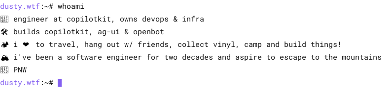
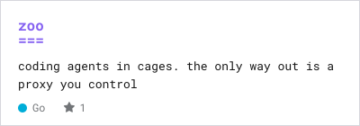
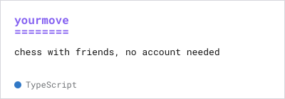
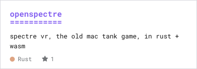
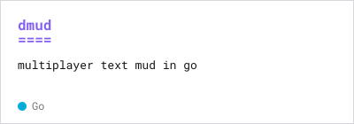
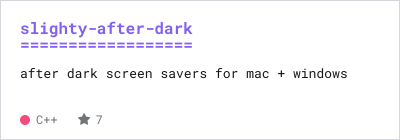
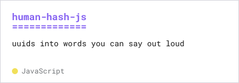

<!-- your intro here -->

<!-- whoami:start -->
<picture><source media="(prefers-color-scheme: dark)" srcset="assets/gen/whoami-dark.svg"></picture>
<!-- whoami:end -->

<picture><source media="(prefers-color-scheme: dark)" srcset="assets/stack-dark.svg"></picture>

<!-- h-contrib:start -->
<picture><source media="(prefers-color-scheme: dark)" srcset="assets/gen/h-contrib-dark.svg"></picture>
<!-- h-contrib:end -->

<!-- contrib:start -->
<a href="https://github.com/CopilotKit/CopilotKit"><picture><source media="(prefers-color-scheme: dark)" srcset="assets/gen/contrib-CopilotKit--CopilotKit-dark.svg"></picture></a> 
<a href="https://github.com/ag-ui-protocol/ag-ui"><picture><source media="(prefers-color-scheme: dark)" srcset="assets/gen/contrib-ag-ui-protocol--ag-ui-dark.svg"></picture></a> 
<a href="https://github.com/CocoaPods/CocoaPods"><picture><source media="(prefers-color-scheme: dark)" srcset="assets/gen/contrib-CocoaPods--CocoaPods-dark.svg"></picture></a> 
<a href="https://github.com/CopilotKit/OpenBot"><picture><source media="(prefers-color-scheme: dark)" srcset="assets/gen/contrib-CopilotKit--OpenBot-dark.svg"></picture></a> 
<a href="https://github.com/fibjs/fibjs"><picture><source media="(prefers-color-scheme: dark)" srcset="assets/gen/contrib-fibjs--fibjs-dark.svg"></picture></a> 
<a href="https://github.com/FGRibreau/mailchecker"><picture><source media="(prefers-color-scheme: dark)" srcset="assets/gen/contrib-FGRibreau--mailchecker-dark.svg"></picture></a> 
<a href="https://github.com/poulainv/tottem"><picture><source media="(prefers-color-scheme: dark)" srcset="assets/gen/contrib-poulainv--tottem-dark.svg"></picture></a> 
<a href="https://github.com/jh3y/tyto"><picture><source media="(prefers-color-scheme: dark)" srcset="assets/gen/contrib-jh3y--tyto-dark.svg"></picture></a> 
<a href="https://github.com/CocoaPods/Core"><picture><source media="(prefers-color-scheme: dark)" srcset="assets/gen/contrib-CocoaPods--Core-dark.svg"></picture></a> 
<a href="https://github.com/yahoo/cocoapods-blocklist"><picture><source media="(prefers-color-scheme: dark)" srcset="assets/gen/contrib-yahoo--cocoapods-blocklist-dark.svg"></picture></a> 
<a href="https://github.com/sandeepmistry/node-xpc-connection"><picture><source media="(prefers-color-scheme: dark)" srcset="assets/gen/contrib-sandeepmistry--node-xpc-connection-dark.svg"></picture></a> 
<a href="https://github.com/CopilotKit/atomic-crm"><picture><source media="(prefers-color-scheme: dark)" srcset="assets/gen/contrib-CopilotKit--atomic-crm-dark.svg"></picture></a> 
<!-- contrib:end -->

<!-- h-mine:start -->
<picture><source media="(prefers-color-scheme: dark)" srcset="assets/gen/h-mine-dark.svg"></picture>
<!-- h-mine:end -->

<!-- mine:start -->
<a href="https://github.com/dustywusty/zoo"><picture><source media="(prefers-color-scheme: dark)" srcset="assets/gen/card-zoo-dark.svg"></picture></a>
<a href="https://github.com/dustywusty/yourmove"><picture><source media="(prefers-color-scheme: dark)" srcset="assets/gen/card-yourmove-dark.svg"></picture></a>
<a href="https://github.com/dustywusty/openspectre"><picture><source media="(prefers-color-scheme: dark)" srcset="assets/gen/card-openspectre-dark.svg"></picture></a>
<a href="https://github.com/dustywusty/dmud"><picture><source media="(prefers-color-scheme: dark)" srcset="assets/gen/card-dmud-dark.svg"></picture></a>
<a href="https://github.com/dustywusty/slighty-after-dark"><picture><source media="(prefers-color-scheme: dark)" srcset="assets/gen/card-slighty-after-dark-dark.svg"></picture></a>
<a href="https://github.com/dustywusty/human-hash-js"><picture><source media="(prefers-color-scheme: dark)" srcset="assets/gen/card-human-hash-js-dark.svg"></picture></a>
<!-- mine:end -->

 

